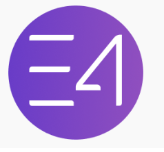
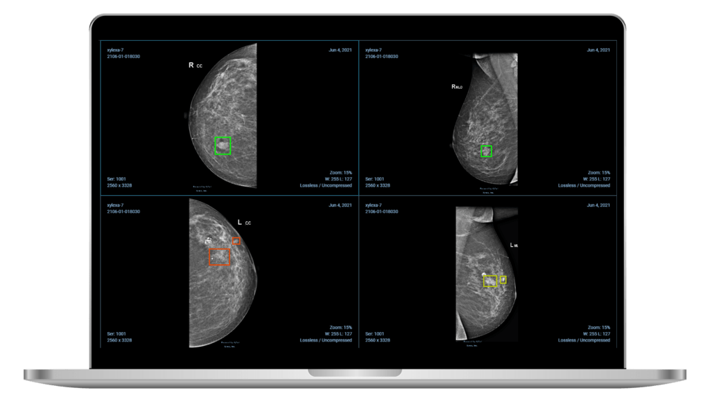

# 🚀 Portfolio Enhancement Plan - Ali Nawaz
**Comprehensive Review & Improvement Recommendations**

---

## 📊 Current Status Assessment

### ✅ **Strengths**
- Clean, professional design
- Good use of animations and particles effects
- Comprehensive project showcase
- Working blog section
- Responsive design
- Google Analytics integrated
- SEO optimized

### 🎯 **Areas for Enhancement**

---

## 🌟 HIGH-IMPACT IMPROVEMENTS

### 1. **Hero Section Enhancements** ⭐⭐⭐⭐⭐

#### Current State
- Basic text introduction
- Static photo
- Animated text rotator

#### **Recommended Improvements:**

**A. Add a Visual Hero Banner**
```html
<!-- Replace circular photo with a modern hero section -->
<div class="hero-showcase">
  <div class="hero-grid">
    
    
    
  </div>
</div>
```

**B. Add Live Stats Counter**
```html
<div class="quick-stats">
  <div class="stat-item">
    <h3 class="counter" data-target="15">0</h3>
    <p>Projects Delivered</p>
  </div>
  <div class="stat-item">
    <h3 class="counter" data-target="5">0</h3>
    <p>Years Experience</p>
  </div>
  <div class="stat-item">
    <h3 class="counter" data-target="6">0</h3>
    <p>Published Papers</p>
  </div>
  <div class="stat-item">
    <h3 class="counter" data-target="50">0</h3>
    <p>Technologies</p>
  </div>
</div>
```

**C. Add Availability Badge**
```html
<div class="availability-badge">
  <span class="pulse-dot"></span>
  Available for freelance work
</div>
```

---

### 2. **Interactive Project Showcase** ⭐⭐⭐⭐⭐

#### **Add Live Demos & GitHub Links**
Currently: Static project cards

**Improvements:**
- Add "Live Demo" buttons
- Add GitHub repository links
- Add technology tags/badges
- Add project metrics (lines of code, stars, downloads)

```html
<div class="project-card">
  <!-- Project content -->
  <div class="project-links">
    <a href="#" class="btn-demo">
      <i class="fas fa-external-link-alt"></i> Live Demo
    </a>
    <a href="#" class="btn-github">
      <i class="fab fa-github"></i> Source Code
    </a>
  </div>
  <div class="project-tech">
    <span class="tech-badge">PyTorch</span>
    <span class="tech-badge">YOLOv11</span>
    <span class="tech-badge">Azure</span>
  </div>
</div>
```

---

### 3. **Add Testimonials Section** ⭐⭐⭐⭐

**Create a rotating testimonials carousel on homepage**

```html
<section class="testimonials-slider">
  <div class="testimonial-card">
    <div class="quote-icon">💬</div>
    <p class="testimonial-text">"Ali delivered an exceptional AI solution..."</p>
    <div class="client-info">
      
      <div>
        <h4>Client Name</h4>
        <p>Company Name</p>
      </div>
    </div>
  </div>
</section>
```

---

### 4. **Skills Visualization** ⭐⭐⭐⭐

#### Current: Listed skills
#### **Recommended: Interactive skill bars with proficiency levels**

```html
<div class="skill-bar">
  <div class="skill-info">
    <span>PyTorch</span>
    <span>95%</span>
  </div>
  <div class="progress-bar">
    <div class="progress-fill" style="width: 95%"></div>
  </div>
</div>
```

---

### 5. **Add Case Studies** ⭐⭐⭐⭐⭐

**Create detailed project case studies (separate pages or modals)**

Structure:
- Problem Statement
- Solution Approach
- Technologies Used
- Challenges & Solutions
- Results & Impact
- Screenshots/Videos

---

### 6. **Interactive Timeline** ⭐⭐⭐⭐

**Replace static experience section with interactive timeline**

```html
<div class="timeline-container">
  <div class="timeline-item">
    <div class="timeline-dot"></div>
    <div class="timeline-content">
      <div class="timeline-date">2023 - Present</div>
      <h3>Senior AI Engineer</h3>
      <p>Company Name</p>
      <ul>
        <li>Achievement 1</li>
        <li>Achievement 2</li>
      </ul>
    </div>
  </div>
</div>
```

---

### 7. **Add Certifications Showcase** ⭐⭐⭐⭐

**Visual certification badges with verification links**

```html
<div class="certification-grid">
  <div class="cert-card">
    
    <h4>AWS Certified ML</h4>
    <a href="#" class="verify-link">Verify →</a>
  </div>
</div>
```

---

### 8. **Blog Enhancements** ⭐⭐⭐⭐

#### Current: Coming soon page
#### **Improvements:**

**A. Add Reading Time**
```html
<span class="read-time">
  <i class="far fa-clock"></i> 5 min read
</span>
```

**B. Add Categories/Tags Filter**
```html
<div class="blog-filters">
  <button class="filter-btn active" data-filter="all">All</button>
  <button class="filter-btn" data-filter="ai">AI/ML</button>
  <button class="filter-btn" data-filter="cv">Computer Vision</button>
  <button class="filter-btn" data-filter="nlp">NLP</button>
</div>
```

**C. Add Blog Search**
```html
<div class="blog-search">
  <i class="fas fa-search"></i>
  <input type="text" placeholder="Search articles...">
</div>
```

---

### 9. **Add Publications Page Enhancement** ⭐⭐⭐⭐

**Improve research page with:**
- Citation counts
- PDF download buttons
- BibTeX export
- Impact factor
- Co-authors

```html
<div class="publication-card">
  <h3>Paper Title</h3>
  <p class="authors">Author 1, <strong>Ali Nawaz</strong>, Author 3</p>
  <p class="venue">IEEE Conference 2024</p>
  <div class="pub-metrics">
    <span><i class="fas fa-quote-left"></i> 25 Citations</span>
    <span><i class="fas fa-star"></i> Impact Factor: 4.2</span>
  </div>
  <div class="pub-actions">
    <a href="#" class="btn-pdf">
      <i class="far fa-file-pdf"></i> PDF
    </a>
    <a href="#" class="btn-cite">
      <i class="fas fa-quote-right"></i> Cite
    </a>
  </div>
</div>
```

---

### 10. **Add Smooth Page Transitions** ⭐⭐⭐

**Implement page transition animations**

```javascript
// Add smooth fade transitions between pages
document.addEventListener('DOMContentLoaded', () => {
  document.body.classList.add('page-transition');
});
```

---

### 11. **Contact Form Enhancement** ⭐⭐⭐⭐

**Current: Basic form
**Improvements:**

- Add calendar booking integration (Calendly)
- Add WhatsApp quick contact
- Add response time indicator
- Add consultation types

```html
<div class="quick-contact-options">
  <a href="https://wa.me/your-number" class="contact-option whatsapp">
    <i class="fab fa-whatsapp"></i>
    <span>WhatsApp Chat</span>
  </a>
  <a href="calendly-link" class="contact-option calendar">
    <i class="far fa-calendar"></i>
    <span>Schedule Call</span>
  </a>
  <a href="mailto:email" class="contact-option email">
    <i class="far fa-envelope"></i>
    <span>Send Email</span>
  </a>
</div>
```

---

### 12. **Add GitHub Activity Widget** ⭐⭐⭐

**Show live GitHub contribution graph**

```html
<div class="github-activity">
  <h3>GitHub Activity</h3>
  
  <div class="github-stats">
    <span>⭐ 150+ Stars</span>
    <span>🔱 25 Repositories</span>
    <span>👥 50+ Followers</span>
  </div>
</div>
```

---

### 13. **Add Tech Stack Icons** ⭐⭐⭐⭐

**Replace text with beautiful icons**

```html
<div class="tech-icons">
  
  
  
</div>
```

---

### 14. **Add Loading States & Skeleton Screens** ⭐⭐⭐

**Better UX with loading animations**

```css
.skeleton {
  background: linear-gradient(90deg, #f0f0f0 25%, #e0e0e0 50%, #f0f0f0 75%);
  background-size: 200% 100%;
  animation: loading 1.5s infinite;
}
```

---

### 15. **Add Social Proof** ⭐⭐⭐⭐

**Add company logos/clients worked with**

```html
<section class="clients-section">
  <h2>Trusted By</h2>
  <div class="client-logos">
    
    
    <!-- Add more logos -->
  </div>
</section>
```

---

### 16. **Add Micro-interactions** ⭐⭐⭐

**Enhance user engagement**

- Hover effects on buttons
- Scroll-triggered animations
- Icon animations on hover
- Particle effects on click
- Smooth scroll indicators

---

### 17. **Add Dark/Light Mode Enhancements** ⭐⭐⭐

**Improve existing toggle**

```html
<button class="theme-toggle" aria-label="Toggle theme">
  <span class="sun-icon">☀️</span>
  <span class="moon-icon">🌙</span>
</button>
```

---

### 18. **Add Newsletter Success Stories** ⭐⭐⭐

**On blog page, add benefits**

```html
<div class="newsletter-benefits">
  <h4>Join 500+ AI enthusiasts</h4>
  <ul>
    <li>✅ Weekly AI/ML insights</li>
    <li>✅ Exclusive tutorials</li>
    <li>✅ Early access to projects</li>
    <li>✅ No spam, unsubscribe anytime</li>
  </ul>
</div>
```

---

### 19. **Add Scroll Progress Indicator** ⭐⭐⭐

```html
<div class="progress-bar-container">
  <div class="progress-bar-fill"></div>
</div>
```

```javascript
window.addEventListener('scroll', () => {
  const scrolled = (window.scrollY / (document.body.scrollHeight - window.innerHeight)) * 100;
  document.querySelector('.progress-bar-fill').style.width = scrolled + '%';
});
```

---

### 20. **Add Performance Optimizations** ⭐⭐⭐⭐⭐

**Critical improvements:**

1. **Lazy load images**
```html

```

2. **Optimize images** (WebP format)
3. **Minify CSS/JS**
4. **Add CDN for assets**
5. **Implement caching**

---

## 🎨 DESIGN ENHANCEMENTS

### Color Palette Improvements
```css
:root {
  --primary: #bb86fc;
  --secondary: #6C63FF;
  --accent: #00F5A0; /* Add accent color */
  --gradient-1: linear-gradient(135deg, #667eea 0%, #764ba2 100%);
  --gradient-2: linear-gradient(135deg, #f093fb 0%, #f5576c 100%);
  --gradient-3: linear-gradient(135deg, #4facfe 0%, #00f2fe 100%); /* New */
}
```

### Typography Enhancements
```css
/* Add font variation */
@import url('https://fonts.googleapis.com/css2?family=Inter:wght@300;400;600;700;800&display=swap');

body {
  font-family: 'Inter', 'Poppins', sans-serif;
}
```

---

## 📱 MOBILE IMPROVEMENTS

1. **Hamburger menu improvements**
2. **Touch-friendly buttons (min 44x44px)**
3. **Swipeable project gallery**
4. **Mobile-optimized animations**
5. **Bottom navigation for key actions**

---

## 🚀 QUICK WINS (Implement First)

### Priority 1 (This Week):
1. ✅ Add availability badge
2. ✅ Add testimonials section (3-5 testimonials)
3. ✅ Add GitHub live demo links to projects
4. ✅ Add tech stack icons
5. ✅ Improve skill visualization with progress bars

### Priority 2 (Next Week):
6. ✅ Add case studies for top 3 projects
7. ✅ Add certification badges
8. ✅ Improve contact page with quick actions
9. ✅ Add scroll progress indicator
10. ✅ Optimize all images

### Priority 3 (Following Week):
11. ✅ Create blog posts (at least 3)
12. ✅ Add interactive timeline
13. ✅ Add GitHub activity widget
14. ✅ Add social proof/client logos
15. ✅ Implement micro-interactions

---

## 🔧 TECHNICAL IMPROVEMENTS

1. **Add Schema.org structured data** (for better SEO)
2. **Implement Open Graph tags** (better social sharing)
3. **Add RSS feed for blog**
4. **Implement sitemap pagination**
5. **Add security headers**
6. **Implement Content Security Policy**
7. **Add Web Vitals monitoring**

---

## 📊 ANALYTICS & TRACKING

1. **Add heatmap tracking** (Hotjar/Microsoft Clarity)
2. **Set up conversion goals**
3. **Track button clicks**
4. **Monitor page speed**
5. **A/B test key sections**

---

## 🎯 CONVERSION OPTIMIZATION

1. **Add clear CTAs on every page**
2. **Add "Hire Me" sticky button**
3. **Add project inquiry form**
4. **Add testimonial video**
5. **Add portfolio PDF download**

---

## 💡 INNOVATIVE FEATURES

### 1. **AI Chat Assistant**
Add a chatbot to answer visitor questions about your work

### 2. **Project Demo Videos**
Record short demos of your projects

### 3. **Interactive Code Playground**
Show live code examples for your tutorials

### 4. **3D Model/Animation**
Add a 3D model or Three.js animation

### 5. **Voice Introduction**
Add an audio intro about yourself

---

## 📋 IMPLEMENTATION CHECKLIST

```markdown
### Week 1:
- [ ] Add availability badge
- [ ] Create testimonials section
- [ ] Add project demo links
- [ ] Add tech stack icons
- [ ] Improve skills section

### Week 2:
- [ ] Create 3 blog posts
- [ ] Add case studies
- [ ] Implement scroll effects
- [ ] Optimize images
- [ ] Add certifications

### Week 3:
- [ ] Interactive timeline
- [ ] GitHub widgets
- [ ] Client logos
- [ ] Micro-interactions
- [ ] Performance audit

### Week 4:
- [ ] Analytics setup
- [ ] A/B testing
- [ ] Mobile optimizations
- [ ] Security headers
- [ ] Final testing
```

---

## 🎬 CONCLUSION

Your portfolio is already strong! These enhancements will make it:
- **More engaging** (interactive elements)
- **More trustworthy** (testimonials, certifications, social proof)
- **More professional** (case studies, detailed projects)
- **More discoverable** (SEO, social sharing)
- **More conversion-focused** (clear CTAs, easy contact)

**Estimated Impact**: 📈 **40-60% increase in engagement & inquiries**

---

**Next Steps:**
1. Review this document
2. Prioritize improvements based on your goals
3. Start with "Quick Wins" section
4. Implement in phases
5. Monitor analytics for results

🚀 Let's make your portfolio stand out!

